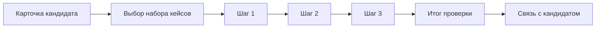

# SkillSim

**Резюме, которое можно запустить**

Интерактивное резюме-симулятор: наниматель за 120 секунд проверяет работу кандидата в деле, а не читает список навыков.

**[Открыть прототип](https://sadnessxdd.github.io/skillsim/)**

---

## Идея

Привычное резюме — документ в формате PDF или страница со списком навыков вроде «HTML — 80 процентов». Такую цифру нельзя проверить, и наниматель вынужден верить на слово.

SkillSim переворачивает шаблон: страница резюме превращается в рабочий стенд. Наниматель запускает код кандидата, пытается его сломать и сравнивает свои ожидания с решениями кандидата.

| | Привычное резюме | SkillSim |
|---|---|---|
| Что делает наниматель | Читает | Запускает и проверяет |
| Что видит | Заявленные навыки | Работающий код и ход мыслей |
| Как оценивается | На слово | По действиям посетителя |
| Время | Не ограничено | 120 секунд |

## Для кого

- **Наниматель.** Хочет быстро понять, как кандидат думает и пишет код, среди сотен одинаковых резюме.
- **Кандидат.** Хочет показать умение делом и выделиться, а не перечислять технологии.

## Как это работает

Таймер на 120 секунд запускается с первого шага. Если время выходит, сайт показывает итог по тому, что успели.

### Наборы кейсов

| Набор | Шаг 1 | Шаг 2 | Шаг 3 |
|---|---|---|---|
| **Проверка форм и ошибок** | Сломать маску телефона: ввести буквы и лишние цифры | Расставить приоритеты дефектов и увидеть выбор кандидата | Запустить ответ сервера с ошибкой и посмотреть, как её перехватывает `try/catch` |
| **Типизация и архитектура** | Выбрать безопасную проверку типа и сравнить с решением кандидата | Запустить бенчмарк мемоизации с реальным измерением времени | Выбрать реализацию без мутации состояния |

### Итог проверки

Результат не задан заранее и считается по действиям посетителя. Две метрики:

- **Совпало с подходом кандидата** — сколько ваших решений совпало с решениями кандидата;
- **Код кандидата выдержал проверки** — сколько запущенных проверок код прошёл.

Цвет полосы несёт смысл: зелёный означает успех, янтарный означает расхождение, красный означает провал.

## Оформление

| Роль | Цвет |
|---|---|
| Фирменный | `#365799` |
| Наведение | `#2c477f` |
| Фон | `#f8fafc` |
| Заголовки | `#0f172a` |
| Успех | `#15803d` |
| Предупреждение | `#b45309` |
| Ошибка | `#b91c1c` |

Шрифты: **Inter** для интерфейса и **JetBrains Mono** для кода, логов и таймера.

## Технологии

- HTML5 и чистый JavaScript без сборки;
- Tailwind CSS через CDN;
- Google Fonts.

Бэкенда нет: бенчмарк измеряется в браузере через `performance.now()`, а ответ сервера в задаче про ошибки имитируется кодом на странице.

## Ограничения прототипа

- Кнопка «Связаться с кандидатом» показывает демонстрационное сообщение, письмо не отправляется.
- Карточка кандидата содержит данные-заглушки.
- Кейсов пока два набора по 3 шага.

## Развитие

- конструктор кейсов, в котором кандидат добавляет собственные задачи;
- ссылка на резюме с личной статистикой нанимателей;
- подключение к образовательным платформам для подтверждения навыков;
- модуль для бирж фриланса и кадровых служб компаний.

## Материалы конкурса

- Описание идеи — `SkillSim_описание.docx`
- Презентация концепции — `SkillSim_концепция.pptx`

---

Проект создан для дистанционного конкурса «SiteHack — взлом шаблонов» в рамках марафона «ДвижИТ».

